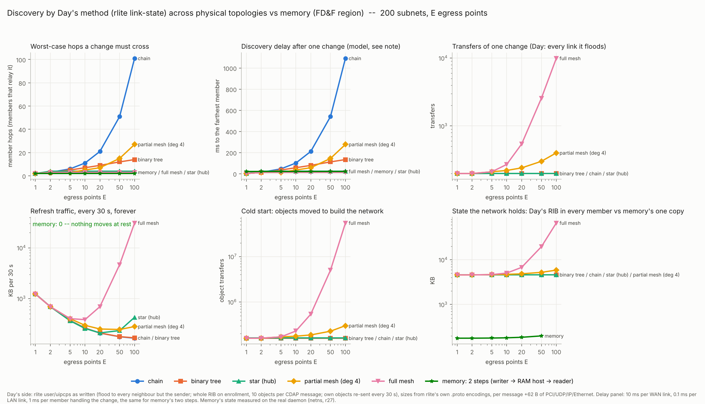

# Test report: the converging tree, and the cost of learning the network

*2026-10-23 · John Fawcett*

## 1. Objective

Day's chapters keep asking whether a property follows from the underlying structure or only from an implementation
choice. This report puts that question to two of his claims.

The first is §2.8.1 of the Chapter 12 draft (2026-10-13, p. 16). It says the converging Create Flow Responses "will
create a spanning tree", and that "because the responses follow the current optimal routing, it's going to be very
close" to optimal. The objective is to find out whether tree structure, reach and near-optimality follow from the
construction, or from conditions the construction happens to meet.

The second is the cost of learning the network. RINA leaves where the RIB lives to policy. The objective is to find
out whether the cost of every member knowing the network follows from RINA's structure, or from the replicated,
flooded RIB that rlite chose. The alternative tested is a shared region in which each member writes only its own facts.

## 2. Summary of results

**Tree structure comes from a choice.** The converging responses form a tree only when every node has one
deterministic next hop. With a per-flow choice among equal paths, two members on a shared node each received the
message twice, at twice the cost. 16 of 1,500 generated graphs were not trees under that rule.

**Reach comes from an assumption about the links.** Used outward from the requester, the tree reaches every member
only if each link a response used also works in the other direction. With about 30% of links one-way, reversed paths
missed members in 30 of 42 graphs. Resolving forward from shared topology state reached every member in all 42.

**Near-optimality comes from neither.** With symmetric links the tree was within 10% of optimal in 88% of 600 graphs.
A shared trunk that members' own shortest paths bypass makes the ratio as large as one likes (3.2× with 8 members in
the example). Asymmetric costs gave 4.5× for one member. The shared-state shortest-path tree is defeated by the same
trunk. Only on acyclic topologies is the tree exactly optimal (470 of 470), and there the topology leaves one path
between any two nodes. Which tree to build is a policy question.

**The topology-dependence of learning the network comes from a policy.** Under rlite's policies, modelled on a
200-subnet network, every cost of knowing the network follows its physical shape. From 1 to 100 egress points: 2 to
101 member hops to the farthest member, 199 to 9,901 transfers per change, and a refresh of 169 KB to 31.6 MB every
30 s for as long as the network exists. In the shared region, measured on the real FrogNet daemon in the sandbox, each member
publishes only its own facts, and the region held 181 to 203 KB from 1 to 50 egress points. Nothing moves at rest.
Only the routes computed from that state reflect the physical network, so an algorithm written against it does not
have to change with the topology.

**On hardware, from memory, at 200 subnets.** The same discovery ran as the simulator's TIER 3 on four of the
author's machines: an x86 laptop, a Raspberry Pi 5 and two Raspberry Pi 4s. It used a real RAM host, a real
`fdf-client` session per node, and FD&F's own graph code planning every node. At every egress count from 1 to 100,
every node's path to every one of the 200 subnets was walked and verified: 40,000 of 40,000, and 40,200 of 40,200
after a node began serving one more subnet. The memory held all 201 members within 2.6 to 10.6 s. The change reached
the memory in 23 to 183 ms and the hub's table in 0.14 to 0.86 s. Each member's read of the whole network was 142 to
156 KB. The tree participants (E2) computed the reference trees on five machines, 960 of 960 steps wherever the run
finished.

## 3. Methodology

### 3.1 The tree

The passage is tested as written. Each member's response takes its routed path to the requester, and the tree is the
union of those paths. Three arms run on the same graphs:

1. the converging tree, under one deterministic next hop per node and under a per-flow choice among equal paths;
2. a shortest-path tree resolved forward by the requester from the topology held as shared state;
3. the exact optimum: the cheapest tree connecting the requester to every member, which is a Steiner tree (on directed
   costs, the minimum Steiner arborescence rooted at the requester). It is computed by Dreyfus–Wagner and cross-checked
   by exhaustive search on every instance; an instance where the two disagree counts as a reference failure.

Cost is one message, summed over the links it crosses. The passage does not say which direction the group's data uses
the tree, so reach is tested for data flowing from the requester outward. Graphs are chains, stars, rings, branching
graphs and asymmetric graphs, with seeds recorded. Each failure is also given as a graph small enough to check by hand.

Each finding is classed by the test in the objective: a property that holds whatever the policy follows from the
construction; one that holds under one policy and fails under another comes from the choice.

### 3.2 The cost of learning the network

One network of 200 subnets, its egress level given 1, 2, 5, 10, 20, 50 and 100 egress points. What each member
contributes is the same in both arms: its own interfaces, addresses and leases. The arms differ in how the others come
to know it.

| | rlite's policies, modelled | Shared region (FD&F) |
| --- | --- | --- |
| How a member's facts reach the others | enrollment, then flooding: each member forwards each new object to every neighbour but the sender; every member's own objects re-sent every 30 s | the member writes its facts once into the region; each reader is woken on change and reads it there |
| What every member holds | the whole link-state database, directory and address table | nothing beyond its own facts: the region holds one copy |
| Implementation | rlite `user/uipcps` as written (link-state routing, fully replicated directory, distributed address allocation); sizes from rlite's own `.proto` encodings | the FD&F region and the FrogNet tunnel daemon, unchanged |
| Obtained by | computation on the graphs | runs: every node in its own network namespace, real kernel routes, real WireGuard |
| Physical layouts | chain, binary tree, star (hub), partial mesh (ring plus chords, degree 4), full mesh | star through the hub only (a FrogNet region's physical layout) |
| Where | the model | sandbox (one machine, 2 CPUs); and the simulator's TIER 3 on four of the author's machines (3.3) |

Two things differ between the columns at once, the coordination mechanism and, for four of the five layouts, the
physical shape. The comparison is between deployments; it does not attribute every difference to one cause.

**Correctness before speed.** A shared-region run counts only when every node holds a route on its expected next hop to
every reachable /24, and every name resolves on every node. Both are checked on every node, by kernel routes and real
lookups.

### 3.3 On hardware

Two runs went to the author's machines, each machine running the whole experiment by itself.

**Learning the network: the simulator's TIER 3** (`simulation/s_scale_tier.py`, the S tier of the FrogNet
simulator). Discovery from memory, with no probe sent and no route followed until the end:
- **The facts:** each node's facts are its rows exactly as `fdf-facts` writes them: its own `.1`; the lease it holds
  on its egress's LAN, with that interface's MAC; its uplink; and, on each egress, every lease it gave and its hub edge.
- **The memory:** a real `fdf-client` session per node announces those facts into a real `rina-host`. The hub
  announces itself the same way.
- **The plans:** every node's plan is `fdf_graph.Graph(participants).plan(node)`, the code FrogNet's `graph_apply`
  turns into the kernel. The egress nodes then publish their plans' maps, and the maps come back through the memory.
- **The verification plan:** this is the only place routes are followed, and it is complete. Every node is walked to
  every served /24 over the nodes' plans and the hub's table, and each path's hops are checked against what the
  topology allows. It is written whole for every run.
- **The event:** the last child starts serving one more /24. Its new facts go through the memory, every plan is
  recomputed, the maps are republished, and the verification plan is walked again.

**The tree participants: E2 distributed** (`e2-dist`). Each node of each of the 160 scenario graphs is a participant
on its own session against the machine's own RAM host. Each step is checked against the reference trees.

### 4.1 The tree

The passage (§2.8.1, p. 16):

> The Create_Flow Responses are sent back to the IPC Process that generated the Request. Some responses will go
> through the same border routers, and they will create a spanning tree! Whoa!
>
> It might not be perfectly optimal spanning tree, but because the responses follow the current optimal routing, it's
> going to be very close.

#### 1. Converging paths form a tree only with one next hop per node

    r ─3─ x ─3─ z ─1─ m1
    r ─3─ y ─3─ z ─1─ m2

Requester r reaches z through x or through y at equal cost; members m1 and m2 hang off z.

| Next-hop rule | Links used | Cost | Copies each member receives |
| --- | --- | --- | --- |
| one deterministic next hop per node | r–x–z, z–m1, z–m2 | 8 | 1 |
| each response chooses among equal paths (per flow) | r–x–z and r–y–z, z–m1, z–m2 | 16 | 2 |
| optimum | r–x–z, z–m1, z–m2 | 8 | 1 |

With a per-flow choice, m1's response goes through x and m2's through y: z joins both branches, and every member
receives the message twice. This holds for any number of members on z (the cost stays 2×). Across 1,500 generated
graphs, 16 were not trees under the per-flow rule.

**Condition needed:** destination-based forwarding with one deterministic next hop per node.

#### 2. Used outward from the requester, the tree reaches every member only if each link it used works both ways

    r ⇄ a ⇄ m      (cost 1 each way)
    m → r          (cost 1, one way only)

(Built by hand.) Member m's shortest path to r is the one-way link m → r, so its response arrives that way. Data must come back over
r → m, which does not exist: m is not reached. Resolving the path forward from the requester gives r → a → m, cost 2.

In 42 strongly connected graphs with about 30% of links one-way, the reversed paths missed at least one member in 30;
forward resolution reached every member in all 42.

**Condition needed:** every link a response used must carry data in the other direction.

#### 3. Near-optimal is not a property of the construction

Shared trunk, symmetric links: r has a direct link of cost 10 to each of k members, and a trunk of cost 9 to a hub h
that reaches each member at cost 2.

    r ─10─ m_i            (each member's own shortest path: 10 < 9 + 2)
    r ─9── h ─2── m_i     (the group's cheapest tree: 9 + 2k < 10k)

| k | Converging tree | Optimum | Ratio |
| --- | --- | --- | --- |
| 2 | 20 | 13 | 1.54 |
| 3 | 30 | 15 | 2.00 |
| 8 | 80 | 25 | 3.20 |

The converging tree costs 10k and the optimum 9 + 2k, so the ratio tends to direct cost / hub-to-member cost (here 5).
Lowering the hub-to-member cost, while keeping each member's direct link its own shortest path, makes the ratio as
large as one likes.

Asymmetric costs, one member: two ways from r to m, one cheap toward r (1 + 1) and dear away from it (9 + 9), the other
the reverse (5 + 5 toward, 2 + 2 away). The response takes the cheap way toward r; data then pays its dear side:
**18 against an optimum of 4 (4.5×)**, for every number of such members.

On 600 generated graphs with symmetric links the tree was within 10% of optimal in 88%, worst 1.89×; with asymmetric
costs, 74%, worst 6.0×.

**Condition needed:** symmetric costs, and members whose individually shortest paths do not bypass a cheaper shared
path. Even then "very close" needs a number.

#### The tree participants on hardware (E2 distributed)

| Machine | Build | Result | Convergence p50 / p99 |
| --- | --- | --- | --- |
| x86 laptop | r30 | 960 of 960 steps equal the reference | 6.4 / 13.9 ms |
| Raspberry Pi 5, 8 GB | r27 | 960 of 960 | 18.7 / 55.6 ms |
| Raspberry Pi 4, 8 GB | r30 | 960 of 960 | 21.2 / 48.0 ms |
| Raspberry Pi 4, 4 GB | r30 | 960 of 960 | 20.4 / 55.3 ms |
| Raspberry Pi 4, 2 GB | r27 | 960 of 960 | 60.8 / 257.4 ms |

On the Pi 5, later builds stopped at scenarios 49, 57 and 90 while setting up a scenario's DAF (5).

#### Structure or choice

All three conditions come from taking the data path by reversing the path a response happened to travel. Forward
resolution from shared topology state removes the reach condition: it reached every member in all 42 one-way graphs.
It also permits a consistent tree: there were no duplicates in any of the 1,500. It does not remove the efficiency
question. It was within 1.9× on the generated graphs, but the shared trunk defeats it as it defeats the converging tree
(3.2× at k = 8). The exact tree is computable from the same state; which tree to build is policy. Tree structure,
reach and efficiency are separate properties with separate conditions.

### 4.2 The cost of learning the network

#### rlite's policies, modelled

With N members and L adjacencies:

    transfers per change        = 2L − N + 1
    refresh messages per 30 s   = Σ over members v of  deg(v) · ⌈(deg(v) + 2) / 10⌉
    time to the farthest member = Σ over the hops on its path of (link delay + processing at the member)

At 200 subnets, from the smallest to the largest value across E = 1 to 100:

| Physical layout | Worst-case member hops | Transfers per change | Refresh per 30 s | Objects moved at cold start | State held across all members |
| --- | --- | --- | --- | --- | --- |
| chain | 2 to 101 | 199 | 1.26 MB down to 169 KB | 159 k | 4.4 MB |
| binary tree | 2 to 14 | 199 | 1.26 MB down to 171 KB | 159 k | 4.4 MB |
| star (hub) | 2 to 4 | 200 | 1.27 MB down to 214 KB | 160 k | 4.4 MB |
| partial mesh | 2 to 27 | 199 to 401 | 1.26 MB down to 250 KB | 159 k to 300 k | 4.4 to 5.9 MB |
| full mesh | 2 to 3 | 199 to 9,901 | 1.26 MB up to 31.6 MB | 159 k to 55 M | 4.4 to 62 MB |

Every term is a property of the physical graph, and the refresh is paid for as long as the network exists. These are
rlite's policy choices, not the only ones RINA allows: where the RIB lives is itself policy.

#### The shared region, measured

A change is two logical operations, a write to the region and a wake of each reader; each crosses whatever links lie
between that member and the region host. No member relays another's facts, and at rest nothing is sent.

    time to the farthest reader = leg(writer) + max over readers of leg(reader) + processing

| E | Resolved (every route right, every name) | Cold start to last node correct | Change to last daemon (p50) | One daemon's CPU per change (p50) | All daemons' CPU per change (p50) | Region state (one copy) |
| --- | --- | --- | --- | --- | --- | --- |
| 1 | yes | 13.9 s | 211 ms | 275 ms | 275 ms | 181 KB |
| 2 | yes | 14.8 s | 276 ms | 185 ms | 375 ms | 181 KB |
| 5 | yes | 21.3 s | 348 ms | 140 ms | 680 ms | 182 KB |
| 10 | yes | 36.7 s | 417 ms | 85 ms | 935 ms | 184 KB |
| 20 | yes | 73.0 s | 697 ms | 85 ms | 1,725 ms | 189 KB |
| 50 | yes | 219 s | 1,532 ms | not measured | not measured | 203 KB |
| 100 | did not run (the sandbox ran out of memory) | | | | | |

Sandbox numbers, one machine with 2 CPUs running every node. As E grows, one daemon's CPU per change falls from 275 to
85 ms while the elapsed time to the last daemon rises from 211 to 697 ms; the CPU of all daemons together reaches
1,725 ms per change at E = 20, about 860 ms on two CPUs. That is consistent with the rise being the daemons queuing for
the machine's two CPUs; a run with one node per machine would measure it directly, and none has been made. The region's mapping table is
16.5 KB at every E; the participant rows grow by each egress point's own rows. CPU figures come from a second run of the
same build on the same bed, which measured them.

#### On hardware: TIER 3, S = 200 (build r30)

Every run verified every path: 40,000 of 40,000 at cold start, and 40,200 of 40,200 after the event, at every E on
every machine.

| Machine | E | Memory holds all 201 members | Maps round | Plan CPU per node, p50 | Each member's read |
| --- | --- | --- | --- | --- | --- |
| x86 laptop, 4 cores | 1 | 2.7 s | 259 ms | 0.66 ms | 156.1 KB |
| | 10 | 2.6 s | 258 ms | 0.26 ms | 154.9 KB |
| | 100 | 2.7 s | 1,337 ms | 0.55 ms | 145.7 KB |
| Raspberry Pi 5, 8 GB | 1 | 2.9 s | 292 ms | 0.72 ms | 152.6 KB |
| | 10 | 3.0 s | 250 ms | 0.28 ms | 151.3 KB |
| | 100 | 2.6 s | 1,580 ms | 0.54 ms | 142.1 KB |
| Raspberry Pi 4, 8 GB | 1 | 9.2 s | 782 ms | 1.98 ms | 152.8 KB |
| | 10 | 8.3 s | 744 ms | 0.73 ms | 151.5 KB |
| | 100 | 7.8 s | 4,188 ms | 1.78 ms | 142.3 KB |
| Raspberry Pi 4, 4 GB | 1 | 10.6 s | 755 ms | 1.88 ms | 152.6 KB |
| | 10 | 10.2 s | 694 ms | 0.70 ms | 151.3 KB |
| | 100 | 10.3 s | 3,859 ms | 1.97 ms | 142.1 KB |

The event, across all seven E on each machine:

| Machine | Change to the memory | Change to the hub's table |
| --- | --- | --- |
| x86 laptop | 23–25 ms | 138–287 ms |
| Raspberry Pi 5 | 27–39 ms | 158–331 ms |
| Raspberry Pi 4, 8 GB | 66–94 ms | 428–862 ms |
| Raspberry Pi 4, 4 GB | 66–183 ms | 448–842 ms |

**Why the numbers move as they do.**
- **The time to fill the memory doesn't grow with E.** Each member announces only its own facts, so 200 members cost
  the same at any egress count. What it depends on is the machine: about 3 s on the laptop and the Pi 5, about 8 to
  11 s on the Pi 4s, where 201 sessions start on four slower cores.
- **The maps round does grow with E.** Each egress publishes its own maps, so at E = 100 a hundred members re-announce
  at once.
- **Each member's read shrinks slightly as E grows.** With more egress points there are fewer children, so fewer
  lease rows and fewer given-lease rows.
- **A change costs one member's write.** It reached the memory in tens of milliseconds and the hub's table in under a
  second, at every E.

#### Structure or choice

Under rlite's policies the cost of knowing the network follows its physical shape: hops, transfers, refresh and the
state every member carries all change with it. Those are rlite's policy choices. RINA's structure does not require
them, because where the RIB lives is itself policy. In the shared region, what an algorithm reads is the same set of
facts whatever the shape; only the routes computed from it reflect the physical network.

## 5. Limits

- The passage is quoted from the draft of 2026-10-13. It does not say which way data uses the tree, so the reach
  finding is stated for data flowing from the requester outward.
- rlite's side is computed from its policies as written, not run.
- The chart's delay panel assumes 10 ms per WAN link, 0.1 ms per LAN link and 1 ms of processing per member that
  handles a change, for both columns.
- The shared region was measured on the hub layout only. Its state does not depend on the layout by construction, but
  other layouts were not run.
- The sandbox's elapsed times include contention for 2 CPUs. E = 100 did not run in the sandbox: the machine ran out of
  memory.
- **The hardware runs are one machine each.** In TIER 3, all 201 members and the RAM host run on the same machine over
  loopback. The times are those of a member, the memory and FD&F's planning on that machine. No run yet spans several
  machines over real WAN legs.
- **The real tunnel daemon was measured only in the sandbox.** The namespace bed that runs it (the measured table in
  4.2) did not work on the author's machines. Each daemon wrote its facts and then lost the bed's hub after 50 to 130 s,
  so no route was ever built. The cause was not found. TIER 3 replaced it on hardware, so its numbers come from FD&F's
  planning code, not from the daemon applying routes to a kernel.
- **On the Pi 5, E2 depended on its SD card.** The harness makes a new DAF for each of the 160 scenarios. A DAF's
  definition and names are permanent records, each fdatasync'd before it is published, and every claim in the region
  waits behind them. One fdatasync on that card took more than 15 s; the stuck thread was caught in it.
  The other machines passed. This comes from the harness's design, not from the property under test: one DAF per run
  would make four such writes in all.

## 6. Suggestions for further investigation

Offered, not yet run:

1. **When the tree is near-optimal.** Which properties of topology, costs and group placement explain the good results,
   and can "very close" become a bounded claim under explicit conditions? A starting point is already in the data: on
   acyclic topologies (chain, star) the tree was exactly optimal in all 470 graphs, under any costs, as it must be,
   since a tree offers only one path between any two nodes. Every deviation needs a cycle that some member's shortest
   path bypasses.
2. **The least coordination that guarantees a tree.** Is one deterministic next hop per node necessary, or can a more
   general rule keep multipath choice while preventing cycles and duplicates?
3. **Determining the group's center dynamically.** The question left open in §2.3: how the root should be chosen as
   membership and demand change, and when moving it is worth the disruption.
4. **Construction during change.** Whether the properties found on a fixed graph survive when membership or routes
   change while the tree is being built.
5. **RIB placement apart from routing policy.** Which results follow from canonical shared state itself, and which from
   where it resides or how members reach it.
6. **Recursive scopes.** Whether the same construction rules and guarantees hold when members span several layers whose
   membership and addresses change independently.

`EXPERIMENTS.md` defines further tests, also not yet run, drawn from Chapters 1 and 3, their appendices, and the
hourglass note: multihoming and mobility as consequences of routing to the node, reach without a global address space,
renumbering one scope, scaling by repeated scopes, instability under a controller against delay in the loop, two-step
forwarding, fragmentation across the IP/TCP split, and whether shared memory keeps its properties on a computing system
when members lose the region.

## Reproduction and sources

On any x86-64 Linux machine as root:

    cd / && tar xvzf - < /tmp/day-claims.tgz
    /opt/fdf/experiments/day-claims/day-claims

That runs E2 and then S (TIER 3, S = 200, E = 1 to 100) on the machine, and writes every verification plan to
`runs/scale-<time>/`.

The tree experiments and the rlite model are `e2_compare.py`, `e2_ref.py`, `s_day_model.py` and `s_plot.py` in
`experiments/day-claims/`.

- [rlite](https://github.com/rlite/rlite): `user/uipcps/uipcp-normal-lower-flows.cpp`, `uipcp-normal-enroll.cpp`,
  `uipcp-normal.cpp`, `uipcp-gpb/BaseRIB.proto`, `user/libs/CDAP.proto`
- [FrogNet Living Network](https://github.com/FawcettJohnW/FrogNet-Living-Network), branch `daf-model`:
  `opt/fdf/src/fdf-source/rinab/experiments/day-claims/` (`EXPERIMENTS.md`, `RESULTS-E2-COMPARE.md`,
  `runs/e2-compare-20261023/`, `runs/scale-20261023/`)
