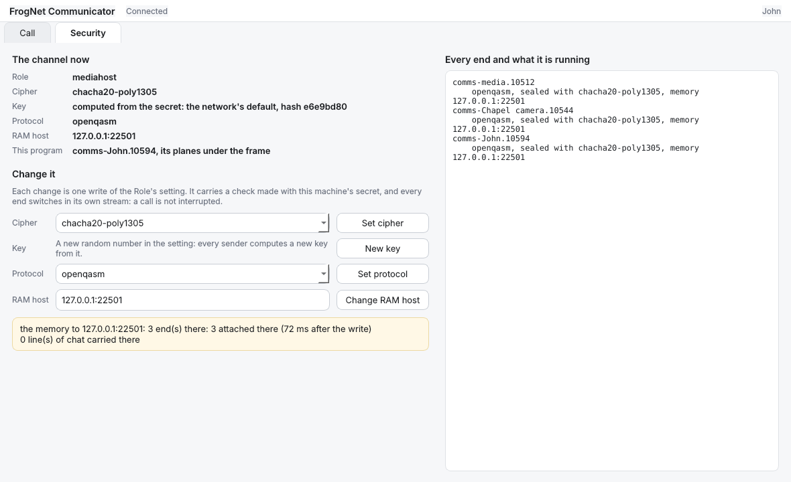

# The Communicator under the protocol layer's frame: design and implementation

2026-11-25 (first issued 2026-11-24). Library builds `channel-frame-cpp-v6-20261124f` (C++) and
`channel-frame-java-v1-20261125a` (the phone), both speaking the frame of `channel-frame-v13-20261123f`. Programs:
`comms-app-2026-11-25-r4`, `comms-android-2026-11-25-r6`.
Written on branch `communicator-keys-20261124`, on top of commit `35f8abc` of `homa-under-croakos-20261116`.

This document describes one piece of work in the FrogNet repository: the audio and video of a Communicator call now
cross the wire inside the same frame the FrogNet nodes' daemons use, sealed under a key that each sender computes,
and the owner of the channel can change the key, the encryption algorithm and the packing protocol while the call
runs, and can move the Communicator's memory to another host while it runs. The three Communicators (C++, Python,
Android) do all of it, and each window has a Security tab that makes those changes. The document covers what was
asked for, the design, the code, how to build and run it, what was measured, and what is not done. Paths are relative to `opt/frognet_semantic/` unless they begin with `src/`, `python/`, `tests/`, `tools/` or
`docs/`, which are relative to `opt/frognet_semantic/ribbit/examples/communicator/`.

## 1. What was asked for

John Fawcett, 2026-11-24:

- "the communicator can use the keys and Cypher and encode the video and audio across the wire. They would be able
  to switch protocols and etc. Without interrupting video."
- "Do them both. Make it a library kind of thing so it can apply to anything." Both means the C++ Communicator and
  the Python Communicator.
- "The communicator should open a permanent tcp socket to the media server", in answer to a lock that was found
  around each socket's writes.
- "also add the code that implements the security model."

And 2026-11-25:

- "I need the Android code updated so it will run."
- "On the UI, add a new tab named Security. On that tab, add the options for the cipher, key, protocol, and a button
  to change the RAM host."

## 2. The pieces that already existed

**The Communicator** (`ribbit/examples/communicator`) is a presence, chat, audio and video application. Each
participant in a call opens two permanent TCP connections to the media server (`comms-media`, port 8994), one for
audio and one for video. Each connection is a *plane* (`fnav::Plane` in C++, `frogcomms.fnav.Plane` in Python). A
plane sends *units*: a 4-byte length, then a body. A plane may shed a body (send nothing) or abort one it has begun
(pad the rest of the declared length with bytes that end in `DE AD BE EF`), so that a slow link costs frames and
never costs time. Call state (who is in which call) is in the Communicator's own shared memory, `comms-ram`, port
8800.

**The protocol layer's frame** (`core/channel_frame.py`, build v13) is what a FrogNet node's daemons put around
every message on a permanently open connection. A channel is named by a *Role*. The Role's *setting* is a tuple that
its owner writes; it says which protocol packs the data, a random number the key is computed from, and the
encryption algorithm. Each machine holds the Role's *secret* in a file. Nothing secret crosses a connection.

## 3. The design

### 3.1 The frame is a library with no socket in it

`core/channel_frame.py`'s `Link` owns its socket and blocks on it. A plane cannot use that: a plane has its own way
of writing a socket, and it sheds and aborts. So the frame was written again as a library in which one object, a
`Codec`, is one end of one connection and never touches a socket:

- `pack(role, message)` returns the bytes to put on the connection.
- `feed(bytes)` takes the bytes that arrived and returns the messages that opened.
- `next()` returns bytes the frame itself owes the far end (a switch, a request to send again, a repeat).
- `undo()` takes back the last unit that `pack()` or `next()` returned, when the program did not put it on the wire.
- `setting(role, setting)` is told the Role's setting whenever the program's held read on it fires.

The bytes are the same as `core/channel_frame.py`'s, so the far end of a connection may be a node's `Link`. The
library needs only libcrypto. Any program with a permanently open connection can use it; the Communicator is its
first user.

### 3.2 What is on the wire

Under the frame, one plane unit carries one or more frames:

    plane unit   <4-byte length> <frame> [<frame> ...] <one byte, 0>
    frame        <length, varint> <packet ID, as the difference from the last> <data, sealed or not>
    data opened  <the protocol's word, 4 bytes> <what that protocol's driver packed>

- **Packet ID** is `counter << 9 | sequence << 1 | reply`. A connection carries up to 256 sequences; each Role gets
  one, named by the first frame sent on it (the Role, the sender's FNID, the setting's number).
- **The protocol's word** says how the data is packed: `TCP\x01` (as it is), `CHO\x03` (chorus: only the difference
  from the last message's first 24 bytes), `OQ3\x02` (openqasm: the difference from the whole last message, up to
  4,096 bytes).
- **Sealed data** is AEAD, `aes-256-gcm` or `chacha20-poly1305`, with a nonce of 8 random bytes and a 4-byte count,
  and the 8-byte packet ID bound in as associated data.
- **Calls** are 4-byte words in place of a protocol word: `SWP` (I switch protocol), `SWE` (I switch encryption),
  `NOT` (your messages from number n did not open here), `AGN` (I start again from number n), `RCV` (I have
  everything before n; sent every 64 messages).
- **The last byte of the unit**, 0, is this work's ([A_WHOLE_UNIT_SAYS_SO_V1]). See 3.5.

### 3.3 The key and the setting

- **The secret** is a file placed by hand on each machine that may carry the Role:
  `/etc/frognet/channel_secrets/<Role>`, or `/etc/frognet/channel_secrets/default` for a Role with no file of its
  own. `FROGNET_CHANNEL_SECRETS` names another directory.
- **The key** is the first 32 bytes of HMAC-SHA384 of the secret over
  `"frognet channel key\n" + sender's ID + "\n" + Role + "\n" + number`. It is computed when needed, never stored and
  never sent. Each sender has its own key, because its ID is in it. A new number is a new key.
- **The sender's ID** is the node's FNID (`/etc/fnid`) on a FrogNet node. A machine that is not a node sends as
  `comms-<participant name>`.
- **The setting** is `{driver, number, protection, step, check}`. `number` 0 means not sealed. `check` is
  HMAC-SHA384 under the Role's secret over the other fields; a process that holds the secret ignores a setting whose
  check does not verify and keeps the one it has.
- **A Role's own secret moves forward.** When the Role has its own secret file, each new key raises `step`, and each
  machine replaces its file with `HMAC-SHA384(secret, "next\n" + Role + "\n" + step)` and erases the old one.

### 3.4 A switch does not interrupt anything

When a process's held read on the setting fires, it tells each plane's `Codec`. The next unit that end sends begins
with the call that says "I switch", packed and sealed the old way; everything after it is the new way. The far end
reads the call and switches its reading side at that exact point in the stream. No connection is closed or opened,
nothing is negotiated, and the two directions of a connection switch independently.

The two ends' held reads do not fire at the same instant. If a frame arrives sealed in a way the receiver cannot
open yet (or can no longer open), the receiver does not take it or anything after it on that sequence, and sends
`NOT` with the number of the first message it lacks. The sender, once its own setting is current, sends `AGN` and
then those messages again under the current key. The receiver counts and skips any it already has. So a late
setting costs a few milliseconds of repeat and loses nothing.

### 3.5 The frame under a plane that sheds and aborts

The frame keeps state on both ends: the last packet ID, the last message for difference packing, the nonce count,
the list of messages kept for a repeat. A plane may decide, after the frame has packed a body, not to send it, or to
abandon it part-way. Two rules keep the two ends' state in step.

- **A unit that did not go whole is taken back.** `Plane::send` calls `pack()`, tries to write the unit, and calls
  `undo()` unless the whole unit went. `undo()` restores the sending state to what it was before that unit. The far
  end is fed exactly the units whose send returned "whole".
- **A whole unit says so.** fnav recognizes an aborted unit by its last 4 bytes. A unit abandoned with 1 to 3 bytes
  left ends in only 1 to 3 padding bytes and passes for whole. That was harmless for a video frame and is fatal for
  the frame's state. So every unit under the frame ends in one byte, 0, which padding can never end in. A receiver
  that sees any other last byte counts the unit as aborted and does not feed it.

### 3.6 One writer per socket

Before this work each plane had a mutex around its socket writes, because in the media server several participants'
threads write to one viewer's socket. That is a lock around a socket, which John's rules forbid: a connection's wire
has one owner.

Now each plane has one writer thread ([ONE_WRITER_PER_PLANE_V1]). `Plane::send` hands the body to the writer and
waits for its verdict (whole, dropped or aborted), so callers see what they saw before. The only guarded thing is
the list of bodies handed over, and it is never held during a write. The writer also sends what the frame owes when
nobody is sending a body, which is what makes a switch or a repeat go out on an idle plane: the `Codec` wakes the
writer through a pipe, and the writer waits on the socket only while something is owed that the socket would not
take. The media server's never-wait rule (debt mode) is unchanged.

### 3.7 Which end speaks the frame

A desktop participant started with `--channel <Role>` speaks the frame. The phone speaks it unless that is turned
off on its Security tab. The media server always can. It reads from the first
unit of each accepted connection which kind the far end is: an fnav body begins with the byte that declares the
plane, and the frame's first unit does not. A participant without the frame is spoken to as before, unless the
setting the server holds for the Role is sealed; then its connection is closed.

A program started with `--channel` reads the Role's setting from the memory before it opens any plane, so nothing of
a sealed Role is sent in the clear at the start of a call.

Every Communicator process holds the read on the Role's setting and reports, whether its planes are under the frame
or not, because that read is also how it follows the memory (3.10). A process without `--channel` holds it for the
default Role, `mediahost`.

### 3.8 Where the setting lives, and how the owner knows it took

The setting is in the Communicator's own memory, because the C++ Communicator builds and runs without a FrogNet
tree:

    (channel, setting, <Role>)      {driver, number, protection, step, ram_host, ram_port, check}
                                    owner: whoever runs comms-channel or uses a window's Security tab
    (channel, at, <Role>:<end>)     {role, end, driver, number, protection, step, sealed, framed, ram, ignored, build}

Each process holds a read on the first tuple; that held read is the only thing that moves a switch. Each process
owns one tuple of the second kind, its report: the setting it is running, or the setting it ignored and why, whether
its planes are under the frame, and the address of the memory it is attached to. A report holds no key and no
secret. A process that stops takes its report with it, and every process writes its report again at least every
10 s, so a reader that asks for reports no older than 25 s never counts a process that died. The owner's write
(the command or a Security tab) writes the setting and then holds a read on the reports until every end shows the
setting or says it ignored it, and gives one line per end that did not take it.

### 3.9 The security model

1. Every body on a plane is sealed under the sender's key for the Role, with the packet ID bound in.
2. Every sender has its own key.
3. No key and no secret crosses a connection, is written to a tuple, or is logged. A secret is shown only as an
   8-character hash.
4. A setting proves itself with its check. Nobody without the secret can change a Role's setting, including turning
   its sealing off, on a machine that holds the secret.
5. A Role's own secret moves forward with each new key, and the old one is erased.
6. No key but the current one is tried. A frame that does not open goes back for a repeat.
7. A sealed Role takes nothing unsealed ([A_SEALED_ROLE_TAKES_NO_UNSEALED_MESSAGE_V1]), and the media server does not
   let in a participant that does not speak the frame while it holds the Role as sealed.
8. The setting is read before any plane is opened.
9. Every end reports what it runs, and the owner's command names any end that ignored a setting.

There is no key exchange. A participant can read a sealed call if and only if its machine holds the Role's secret.

### 3.10 The memory moves ([THE_MEMORY_MOVES_V1])

"Change RAM host" moves the Communicator's memory to another comms-ram that is already running, under a running
call. It is the Communicator's form of the RAM host switch in part L of the protocol layer's hardware test.

- **The address is in the setting.** `ram_host` and `ram_port` are two more fields of the Role's setting, under the
  same check. So one tuple, one check and one held read carry it, and nobody without the secret can send the
  participants somewhere else.
- **The owner writes the setting at the new address first, then at the old one.** A process that arrives at the new
  address finds a setting that names where it already is, so it stays.
- **Every process follows by its held read.** The read on the setting fires; the process ends its sessions to the old
  memory, attaches to the new one, asserts its own tuples there (presence, the calls it offers and is in, its
  download cap, its report) and sets up its held reads again. The media server's two memory loops do the same.
  Nothing is copied by a participant and no participant asks another anything.
- **The chat is carried by the owner.** A line of chat has no owner to assert it again, so the one who moves the
  memory copies the chat to the new address before the move.
- **The call is not touched.** Its audio and video go to the media server, not to the memory.
- **The owner's write returns** when every end that was at the old address reports from the new one. An end that
  ignored the move (its check did not verify there) says so at the old address, and the owner is told which.

After the move the old comms-ram is not needed and can be stopped.

### 3.11 The Security tab

Each of the three windows has two tabs, Call (Room on the phone) and Security. Security shows the Role, the cipher,
the key (never the key: which secret it is computed from, as 8 characters of a hash), the protocol, the RAM host,
this program's own state, and every end with what it is running. Its controls are the owner's changes: the cipher
(not sealed, aes-256-gcm, chacha20-poly1305), New key, the protocol (tcp, chorus, openqasm) and Change RAM host.
Each is the same one write the command makes, by the same code, and its answer is shown ("3 end(s) there: 3 running
it (9 ms after the write)"). The phone also has Import secret… (a file of 32 bytes or more becomes the phone's
default secret, in the app's private storage) and a switch for whether the phone speaks the frame.

## 4. The implementation

### 4.1 Files

| File | Lines | What it is |
|---|---|---|
| `ribbit/cpp/include/channel_frame.hpp` | 224 | the library's interface |
| `ribbit/cpp/src/channel_frame.cpp` | 854 | the frame: settings, secrets, keys, sealing, the three protocols, calls, repeats, `undo` |
| `ribbit/cpp/src/channel_frame_c.cpp` | 147 | the same for any language that calls C (`libchannel_frame.so`) |
| `ribbit/cpp/python/channel_codec.py` | 166 | the Python binding (ctypes) |
| `ribbit/cpp/tests/test_channel_frame_oracle.py` | 434 | the library against `core/channel_frame.py`'s `Link` |
| `src/fnav/plane.{hpp,cpp}`, `src/fnav/net.{hpp,cpp}` | +243 | one writer per plane, the frame under a plane, the unit's last byte |
| `python/frogcomms/fnav.py` | +164 | the same in the Python plane |
| `src/comms/channel.{hpp,cpp}` | 261 | a process's channel: the held read, the check, the report, every plane told |
| `python/frogcomms/channel.py` | 169 | the same in Python |
| `tools/comms_channel.cpp` | 153 | the owner's command |
| `src/comms/call.cpp`, `src/media/server.cpp`, `src/media/main.cpp`, `src/feed/main.cpp`, `src/app/main.cpp`, `python/frogcomms/call.py`, `python/comms_feed.py`, `python/comms_app.py` | +44 | planes put under the frame; `--channel` |
| `src/comms/ram_at.hpp`, `python/frogcomms/ram_at.py` | 54, 60 | where the memory is, for this process, and who is told when it moves |
| `src/comms/room.{hpp,cpp}`, `src/media/speed.{hpp,cpp}`, `python/frogcomms/room.py` | +137 | the room and the media server's memory loops follow the memory |
| `src/app/main.cpp`, `python/comms_app.py` | +367 | the Security tab on the two desktop windows |
| `tests/test_channel.cpp` | 255 | planes and the media server under the frame |
| `tests/py/test_call_under_the_frame.py` | 145 | a real call across C++ and Python |
| `tests/py/test_the_memory_moves.py` | 152 | the memory moved twice under a real call |

The phone (`opt/fdf/src/frognet-android`, package `net.frognet.communicator`):

| File | Lines | What it is |
|---|---|---|
| `core/ChannelFrame.java` | 948 | the frame in Java: the C++ library rule for rule, with `javax.crypto` |
| `core/Channel.java` | 393 | the phone's channel, its held read and report, and the owner's `show` and `change` |
| `core/RamAt.java`, `core/Tuples.java` | 49, 58 | where the memory is; the tuples API for the channel service |
| `core/Plane.java`, `core/Room.java`, `core/CallCore.java` | +241 | one writer per plane, the frame under it, the two fnav fixes; the room follows the memory |
| `CommunicatorActivity.java` | +236 | the Room and Security tabs, Import secret…, the channel read before the room is joined |
| `communicator-test/FrameProbe.java`, `test_android_frame.py` | 104, 446 | the Java frame against the C++ library |
| `communicator-test/Probe.java`, `test_android_secure.py` | +76, 161 | the Java core in a sealed call, as viewer, owner and feed |

The Communicator vendors the platform code it builds with, so the four library files are also in
`third_party/ribbit/cpp/`, identical.

### 4.2 The library (`namespace channel_frame`)

    struct Setting { std::string driver; uint64_t number; std::string protection; long step; };
    struct Message { std::string role; int sequence; uint64_t counter; bool reply; Bytes data; };

    class Codec {
        Codec(bool opener, std::string far, std::string fnid = "", std::string secrets = DEFAULT_SECRETS, Say say = nullptr);
        void setting(const std::string& role, std::optional<Setting> s);     // anyone's
        void when_owing(std::function<void()> wake);                        // called when the reader makes the writer owe something
        bool pack(const std::string& role, const Bytes& message, Bytes& unit);   // the writer's
        bool pack_reply(const std::string& role, int sequence, uint64_t counter, const Bytes& message, Bytes& unit);
        bool next(Bytes& unit);                                             // the writer's
        void undo();                                                        // the writer's
        void feed(const uint8_t* p, size_t n, std::vector<Message>& out);   // the reader's
    };

    Taken take_setting(role, fields, secrets_dir);     // proves a setting's check; moves the Role's own secret forward
    std::string check_of(role, fields, secrets_dir);   // the check a setting must carry
    void register_driver(...); void register_protection(...);   // a program's own protocol or algorithm

- **Threads.** One thread writes a connection and one reads it. `pack`, `next` and `undo` are the writer's; `feed`
  is the reader's; `setting` is anyone's. One mutex guards this end's copy of the settings and the list of things the
  reader hands the writer (a request to send again, an acknowledgement). No socket is involved.
- **`undo`.** Everything the writer changes is in one struct, copied before each `pack` or `next`; `undo` puts the
  copy back.
- **`pack` returns false** while messages are being sent again; the plane counts that body as dropped.
- **Errors.** `Gone` means the connection cannot go on, with the reason as text. `DoesNotOpen` means this machine
  cannot make the key or the check.
- **C interface:** `cf_open`, `cf_close`, `cf_setting`, `cf_pack`, `cf_pack_reply`, `cf_next`, `cf_undo`, `cf_feed`,
  `cf_message`, `cf_said`, `cf_running`, `cf_counts`, `cf_take_setting`, `cf_check_of`, `cf_build`, `cf_free`. The
  Python binding finds the library in the folder named by `CHANNEL_FRAME_LIB`, then beside itself, then in `../bin`.

### 4.3 The plane

    void Plane::set_channel(std::shared_ptr<channel_frame::Codec> codec, std::string role, bool by_first_frame = false);
    bool Plane::framed() const;

`set_channel` is called before the first send or receive. `by_first_frame` is for the accepting end.

- `send(body)` hands the body to the writer thread. The writer first writes anything the frame owes, then packs the
  body, appends the 0 byte, and writes the unit under the plane's existing rules. If the unit did not go whole it
  calls `undo()`.
- `recv()` reads units. Under the frame it checks the last byte, feeds the unit, and returns the messages that
  opened, one per call. A unit that held only calls yields nothing and the next unit is read.
- The Python plane does the same with a writer thread, a queue and a socket pair to wake it.

### 4.4 The channel

One `comms::Channel` per process (`frogcomms.channel.Channel` in Python):

- `channel_for_program(role, me, ram_host, ram_port)` makes it and waits up to 10 s for the first read of the
  setting before returning.
- `ChannelWatch` holds the read on `(channel, setting, <Role>)` on its own connection to the memory, and writes this
  process's report after each read.
- `Channel::read(fields)` proves the check with `take_setting`. A setting that does not verify is ignored and the
  one held is kept. A setting that verifies is given to every `Codec` the channel has made.
- `Channel::codec(opener, far)` makes a plane's end of the frame, starting from the setting held then.

The owner's work is in the same library (`channel_show`, `channel_change`, `channel_secret_line` in C++;
`show`, `change`, `secret_line` in `frogcomms.channel`; `Channel.show`, `Channel.change`, `Channel.secretLine` on the
phone). The command and the three Security tabs call it.

### 4.5 The owner's command

    comms-channel --ram HOST:8800 show [ROLE]
    comms-channel --ram HOST:8800 set ROLE --protocol tcp|chorus|openqasm
    comms-channel --ram HOST:8800 set ROLE --seal [--algorithm aes-256-gcm|chacha20-poly1305]
    comms-channel --ram HOST:8800 set ROLE --new-key
    comms-channel --ram HOST:8800 set ROLE --algorithm A
    comms-channel --ram HOST:8800 set ROLE --unseal
    comms-channel --ram HOST:8800 move ROLE NEWHOST:NEWPORT
    comms-channel secret ROLE

The words are `core/channel_admin.py`'s. `set` makes the check with this machine's secret, so it is run on a machine
that holds it. `--wait SECONDS` (default 10) is how long a write waits for the ends' reports. Example output, with
one participant holding a different secret:

    mediahost: driver=tcp, number=512137311650107283, protection=aes-256-gcm
      comms-Stranger.12431 IGNORED it: its check does not verify against this machine's secret for mediahost; nothing is written
      3 end(s) there: 2 running it, 1 ignored it (9 ms after the write)

### 4.6 The phone

The Android Communicator is Java with no native code, so the frame was written a third time, in Java
(`core/ChannelFrame.java`), from the C++ library. AES-256-GCM and HMAC-SHA384 are in every Android the app runs on;
ChaCha20-Poly1305 needs Android 9 (API 28) or later, and the Security tab says so on an older phone. The phone sends
as `comms-<name>`. Its secrets are in the app's private files (`files/channel_secrets/default`), put there with
Import secret…. The phone's plane has the same one writer thread and the same two fnav fixes as the desktop planes.
The kart app, which compiles this Communicator in, does not make a channel: its calls are as they were.

## 5. Building and running

    cd opt/frognet_semantic/ribbit/examples/communicator
    bash build.sh                                          # builds everything into build/

Place the same secret on every machine that may be in the call (any 32 bytes or more):

    mkdir -p /etc/frognet/channel_secrets && head -c 48 /dev/urandom > /etc/frognet/channel_secrets/default

Then:

    comms-ram   --listen 0.0.0.0:8800
    comms-media --listen 0.0.0.0:8994 --ram HOST:8800
    comms-app   --ram HOST:8800 --media HOST:8994 --name John --channel mediahost
    comms-feed  --ram HOST:8800 --media HOST:8994 --name "Chapel camera" --video FILE --channel mediahost
    python3 python/comms_app.py --ram HOST:8800 --media HOST:8994 --name Donna --channel mediahost
    comms-channel --ram HOST:8800 set mediahost --seal

Or open the window's Security tab and use Set cipher. To move the memory, start a second comms-ram and name it:

    comms-ram --listen 0.0.0.0:8800                       # on the other machine
    comms-channel --ram HOST:8800 move mediahost OTHERHOST:8800

On the phone: open the Communicator from the FrogNet member as before, then Security, Import secret…, and choose the
same secret file.

The tests:

    build/test_channel                                         # about 40 s
    python3 tests/py/test_call_under_the_frame.py build        # about 60 s; needs numpy and av
    cd ../../cpp && g++ -std=c++17 -O2 -fPIC -fvisibility=hidden -Iinclude -shared src/channel_frame.cpp src/channel_frame_c.cpp -o bin/libchannel_frame.so -lcrypto \
      && python3 tests/test_channel_frame_oracle.py            # about 60 s

    python3 tests/py/test_the_memory_moves.py build             # about 50 s
    bash ../../../../fdf/src/frognet-android/communicator-test/run_tests.sh .    # the phone's core: about 3 minutes; needs a JDK and ffmpeg

Each prints one PASS or FAIL line per check and ends with `RESULT PASS`.

## 6. What was measured

All on one 2-core Linux machine, 2026-11-24, over loopback.

### 6.1 A real call

`tests/py/test_call_under_the_frame.py`: the C++ `comms-feed` sends the stock 720p video and a 440 Hz tone through
`comms-media` to a Python viewer. All three are under the frame and the Role is sealed from the start. Video frames
are 42 ms apart and audio blocks 20 ms apart. The ranges are over four runs.

| | video frames/s | audio blocks/s | longest time with no new frame | with no new audio block |
|---|---|---|---|---|
| 6 s, nothing switched | 23.9 | 50.0 | 51 to 61 ms | 30 to 31 ms |
| 21 s, nine switches | 23.9 to 24.0 | 50.0 to 50.1 | 51 to 61 ms | 31 to 42 ms |

The nine switches were: new key, chorus, chacha20-poly1305, openqasm, new key, not sealed, sealed, tcp, new key. All
nine reached the viewer, the media server and the feed. The picture stayed 1280x720 and the tone 440.0 Hz, with 0
decode errors. A viewer whose machine holds another secret joined the sealed call for 4 s and got 0 video frames and
0 audio blocks. In the other direction, a Python feed watched by the C++ viewer, both sealed, delivered 119 to 120
frames in 5 s.

### 6.2 Planes

`build/test_channel`, 9 of 9 runs passing with nothing else on the machine:

1. Two planes under the frame, 3,000 bodies each way, 18 to 26 switches under the stream, one end never waiting and
   the other reading in 450 ms stalls. The never-waiting end shed or aborted about 1,000 of its 3,000. Exactly the
   bodies whose send returned "whole" arrived, in order and intact.
2. A far end that does not speak the frame is recognized from its first unit and spoken to as before.
3. Through the media server, 8 switches under 7 s of audio: 350 of 350 blocks arrived; the longest gap between two
   blocks was 22 to 40 ms.
4. A participant with another secret heard 0 blocks and none of its 25 blocks was passed on.
5. A participant with no frame was not let into the sealed call.

### 6.3 The library against the nodes' own code

`ribbit/cpp/tests/test_channel_frame_oracle.py` connects `core/channel_frame.py`'s `Link` to the library in both
directions, then the library to itself. 30 checks pass: not sealed, sealed, new keys, both algorithms, the three
protocols, a sender that switches 40 messages before the receiver's setting arrives (none taken until it does, then
all 40 in order), a Role's own secret at steps 0, 1 and 2, `undo`, 200 random rounds with about 95 switches, another
secret (nothing delivered), the setting's check (the library's equals the node's), and a loss asked for twice.

### 6.4 The Communicator's existing tests

On the one-writer plane, without the frame: `test_call`, `test_call_audio`, `test_media_rates`, `test_media_link`,
`test_jitter`, `test_bottom`, `test_edges`, `test_frame`, `test_segment`, `test_bearer` and
`tests/py/test_call_interop.py` pass. `test_media_rates` passed 9 of 10 runs here and 3 of 3 on the tree before
this work; the one failure was not repeated. `test_plane` needs the original `fnav.py`, which is not in the repository, and was not run.

### 6.5 The memory moved under a call

`tests/py/test_the_memory_moves.py`: two comms-ram, A and B; the media server, the C++ feed and a Python viewer start
on A, under the frame, sealed. Ranges are over the four runs made; the last line's longest gap is from one of them.

| | video frames/s | audio blocks/s | longest time with no new frame | with no new audio block |
|---|---|---|---|---|
| 6 s, nothing changed | 23.9 | 50.0 to 50.1 | 52 to 61 ms | 32 to 33 ms |
| across the move from A to B | 23.8 to 24.0 | 49.9 to 50.1 | 61 ms | 30 to 31 ms |
| 5 s after A is killed, a new key set at B | 23.8 to 24.0 | 49.9 to 50.0 | 51 ms | |
| across a second move, to a new comms-ram | 23.8 to 24.0 | 49.9 to 50.0 | 71 ms | |

The owner's command returned 0.03 to 0.18 s after it was started, saying "3 end(s) there: 3 attached there (13 to
115 ms after the write)". At B the viewer's room showed the feed, the feed's call and the line of chat said at A. A
C++ viewer started with B's address found the call there and watched it (118 to 119 frames in 5 s). A participant
whose machine holds another secret ignored the move and stayed where it was, and the owner was told so by name.

### 6.6 The phone

`opt/fdf/src/frognet-android/communicator-test/run_tests.sh`. The phone's core runs on the JVM here: the same classes
the app runs. No phone and no emulator was used.

- **The Java frame against the C++ library** (`test_android_frame.py`): 32 checks pass, Java opening, C++ opening,
  and Java at both ends: the three protocols sealed and not, both algorithms, new keys, a sender 40 messages ahead of
  the receiver's setting, 40 of 120 units taken back with `undo`, 200 random rounds with about 30 switches, another
  secret, an unsealed sender into a sealed end, a loss asked for twice; the setting's check equal on 50 of 50
  settings; a Role's own secret file moved forward to the same bytes as the C++ library's at steps 0, 1, 2 and 5.
- **The phone in a sealed call** (`test_android_secure.py`), watching the C++ feed's 720p video and tone:

| | video frames/s | audio blocks/s | longest time with no new frame | with no new audio block |
|---|---|---|---|---|
| 6 s, nothing changed | 23.9 to 24.0 | 50.1 to 50.2 | 61 to 73 ms | 31 to 34 ms |
| 14 s, nine switches made by the phone's owner code | 23.9 | 49.9 to 50.0 | 73 to 82 ms | 34 to 41 ms |
| 7 s, the phone's owner code moves the memory, then the old one is killed | 23.8 to 23.9 | 50.0 to 50.1 | 84 to 85 ms | 31 to 35 ms |

  All nine switches answered "3 end(s) there: 3 running it" (14 to 26 ms after the write), and the move "3 end(s)
  there: 3 attached there (52 to 54 ms after the write)". At the end the phone was attached to the new memory, saw
  the feed and its call there, and had the chat it said before the move. A phone with another secret got no frame
  and no block. A phone that does not speak the frame had its planes closed by the media server. The phone as a
  feed, under the frame and sealed, was watched by the C++ viewer (119 frames in 5 s).
- **The phone's existing tests** on the one-writer plane, without the frame: 27,095 vectors equal to Python's; the
  core against comms-ram, comms-media and the C++ and Python Communicators: pass.
- **The app's screen code** type-checks against the Android 14 framework (93 classes). It was not run.

### 6.7 The Security tab's buttons

The C++ window and the Python window were each run against a live call with their four buttons pressed in turn by
the window itself (`--security "cipher …;key;protocol …;ram HOST:PORT"`): each change answered "3 end(s) there: 3
running it" in 1 to 10 ms, and Change RAM host "3 end(s) there: 3 attached there" in 69 to 72 ms. The picture in 3.11
is the C++ window after that run.

## 7. Faults found by running under load, and fixed

The first check of `test_channel` was run more than 300 more times with one or both cores kept busy by other work.

1. **The library sent fewer messages again than it had announced.** [A_REPEAT_ONCE_ANNOUNCED_IS_SENT_WHOLE_V1] When
   the far end asked twice for the same loss, and its acknowledgement of the first repeat arrived during the second,
   the library skipped the acknowledged messages. The far end counts what it skips, so it then skipped new messages:
   10 to 300 bodies lost, in about 1 run in 20 under load. The fault was in this library only; `core/channel_frame.py`
   sends a repeat in one piece. Oracle check 12 reproduces it: 201 of 251 messages arrive without the fix and 251 of
   251 with it.
2. **fnav wrote padding over a unit's length.** [THE_LENGTH_IS_NEVER_PADDED_V1] When the socket took fewer than the 4
   length bytes of a unit and the plane then gave the unit up, the padding went where the rest of the length
   belonged. The far end read a length nobody sent (2.9 GB in the run that was caught under a debugger) and waited
   for ever. This fault was in fnav before this work, in C++ and Python, with or without the frame. Now the rest of
   the length goes as it is and only the body is padding.
3. **A plane whose writer failed left both ends waiting.** [A_BROKEN_PLANE_IS_CLOSED_V1] Now the writer prints why on
   stderr and shuts the socket down, so this end's reader and the far end both read "closed".

After these fixes, with both cores busy, 175 of 182 runs passed and none hung. The 7 that failed all ended on a rule
fnav already had and that was not changed: a sender that waits (a participant, not the media server) ends the
connection when a unit it began cannot be finished in 250 ms and its padding cannot go in another 250 ms. At that
moment the kernel had dropped segments at a full receive buffer and TCP was waiting 400 to 800 ms to send them again
(`ss` showed `rto:408 backoff:1 cwnd:1 lost:1` on both sockets, with empty receive queues).

## 8. Where the library differs from `core/channel_frame.py` v13

Both differences are in what a receiver does. The calls on the wire are the same, and the oracle passes with either
end being the node's code.

1. **A sealed Role takes nothing unsealed.** In v13 a sender that names its sequence unsealed has its unsealed
   messages taken even when the receiver's setting for the Role is sealed. Oracle check 11 measures both: the node's
   `Link` takes 5 of 5 such messages and the library takes 0. This is not fixed in the nodes' code.
2. **A receiver two settings ahead retries.** [TWO_SETTINGS_AHEAD_IS_NOT_A_STRANGER_V1] When a receiver has read
   "sealed" and then "not sealed" before the sender's switch to sealed arrives, v13 ends the connection. The library
   asks for the messages again. This is not changed in the nodes' code either.

## 9. Not done

- **The Android app was not built into an APK and not run on a phone or an emulator** (no Android SDK here). Its core
  ran on the JVM in every test above, and its screen code type-checks. The Security screen has not been seen on a
  phone.
- The Windows build was not built or run. The Windows paths (the writer's waker, and a Role's own secret, which on
  Windows is stepped in memory and not rewritten on disk) are written and not compiled.
- Nothing was run on separate machines.
- The setting is in the Communicator's own memory, not the ControlRam. A node's `channel_admin.py` does not write
  it; `comms-channel` and the Security tabs do.
- "Change RAM host" needs a comms-ram already running at the new address. It does not start one.
- Invitations still ringing when the memory moves are not carried: the caller's offer is asserted at the new address,
  and an invitation is written again when the caller invites again.
- Nothing is committed. The work is on local branch `communicator-keys-20261124`.
